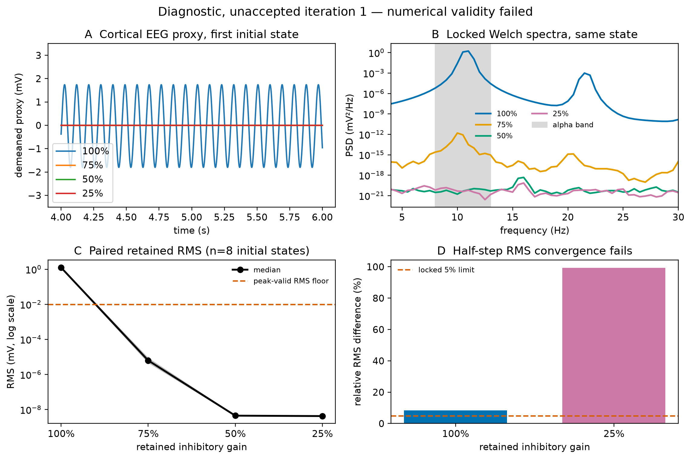

# Generating an Alpha Rhythm by Weakening Inhibition

- Report status: draft
- Scientific outcome: invalid
- Review outcome: REFUSE
- Research question: can a resting E-I cortical population circuit generate an alpha-like rhythm, and how does its simulated EEG proxy change when effective inhibition is reduced to 75%, 50%, and 25% of baseline?
- Evidence available: locked specification; implementation and repeated tests; repeated acceleration/parity evidence; immutable smoke run; completed production runs `/workspace/runs/alpha-production-20261102-i1` and `/workspace/runs/alpha-production-20261102-i2`; exact replication comparison `/workspace/replication-comparison-iteration-2.json`; inspected unaccepted diagnostic figure and manifest.
- Missing evidence: an independent Codex review with working read access. Iteration 1 was refused before evidence inspection because the review sandbox could not create its namespace; no scientific or implementation finding was made.
- Current conclusion: provisional and invalid—the baseline produced a reproducible 11 Hz cortical EEG-proxy rhythm, while all weakened-gain conditions settled below the locked oscillation floor; however, the run failed the prespecified half-step convergence criterion (8.37% baseline RMS discrepancy and an ill-conditioned near-zero relative comparison at 25%), so this pattern is not accepted scientific evidence.
- Next action: iteration 2 step 1, restudy the affected review/access workflow, verify unchanged artifact readability, then repeat the independent review through a fresh reviewer call.

## Locked design

The experiment uses BrainMass's physiological Jansen-Rit cortical-column neural mass. It varies only inhibitory postsynaptic gain `Ai` and evaluates all four levels over eight paired initial conditions. The primary simulated EEG signal is the model's public pyramidal cortical EEG proxy in mV; it is not a calibrated scalp voltage. Full success, validity, and claim limits are prespecified in [NeuroSpecification.md](/workspace/NeuroSpecification.md).

All result claims in this draft are provisional until an independent step-5 review returns `PASS`.

## Independent review status

Iteration 1 returned `REFUSE` in [reviews/iteration-1.md](reviews/iteration-1.md), thread `01a19a52-af19-7ed0-ab7c-685a1c9ea13f`. The sole finding was reviewer-environment access failure before any file could be opened. The scientific run remains unchanged and unaccepted.

Iteration 2 repeated the six checks, acceleration parity, and the immutable deterministic production run without any scientific or source change. Both full and half-step numeric bundles, metrics, convergence, and assessment are byte-identical to iteration 1. This establishes reproducibility of the invalid result, not scientific validity.

## Iteration-1 diagnostic result (unaccepted)

The top-left panel shows the demeaned cortical EEG proxy for the prespecified first initial state over 4–6 s: the 100% condition oscillates at visible alpha cadence while the weakened conditions are effectively flat. The spectrum confirms an 11 Hz baseline peak; the raw paired RMS panel shows that every weakened condition falls below the 0.01 mV peak-validity floor across all eight deterministic initial states. The convergence panel is decisive for validity: both tested step-size comparisons exceed the locked 5% RMS limit. This is diagnostic model output, not accepted evidence about cortex or scalp EEG.
