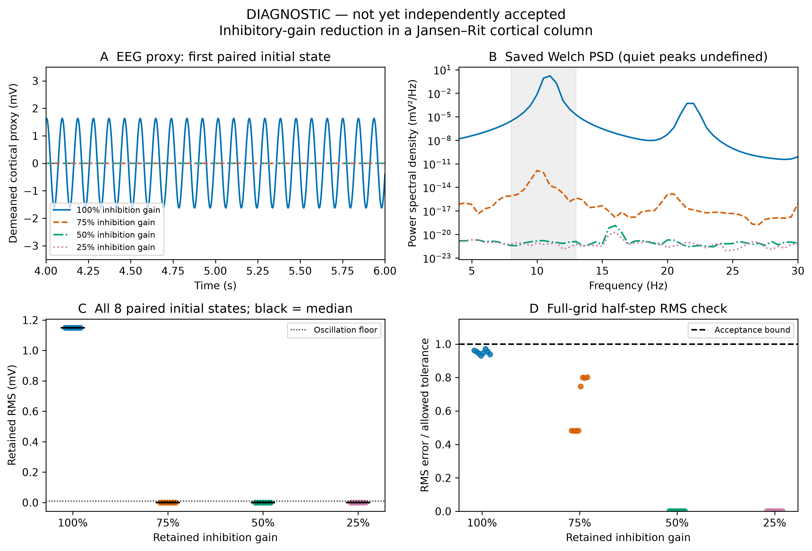

# 皮层 α 节律与抑制减弱：Jansen–Rit 模拟

- Report status: draft
- Scientific outcome: supported
- Review outcome: pending
- Research question: 静息皮层群体模型能否产生类 α 节律，抑制减弱后 EEG 代理信号如何变化？
- Current conclusion: 数值检查通过的模型结果，等待独立复审；不是实测 EEG 或临床结论。
- Evidence available: 32 条件完整扫描、全网格半步长比较、原始 E/I/EEG 数据、独立重复、10 项测试、诊断图及源文件快照。
- Missing evidence: 第 3 轮独立 reviewer 的最终判定。
- Next action: fresh independent review of iteration 3, then final visualization only after PASS.

## 模型与实验

使用 BrainMass 的 JansenRitStep（三群体皮层柱），数值方法显式固定为公开文档中的 exp_euler。
仅改变抑制性突触后电位增益 Ai：22、16.5、11、5.5 mV，分别保留基线的 100%、75%、50%、25%。
所有条件共享 220 Hz 恒定外部驱动和 8 个确定性配对初始条件，其余生物学参数不变。
每条轨迹模拟 6 秒，去掉前 2 秒；在完全对齐的 1 ms 时刻分析后 4 秒。
使用 BrainState 的 for_loop、vmap 与整体 JIT；BrainUnit 量保留至文件/统计边界，Welch 频谱由 BrainTools 计算。

研究者已明确批准四档扫描、授权其余设置并继续。数值协议在新结果产生之前作了显式修订，见
[规格](NeuroSpecification.md)、[前瞻数值修订](NUMERICAL_PROTOCOL_AMENDMENT.md)和
[第 3 轮学习记录](brainx-study-record-iteration-3.md)。

## 当前结果（待独立复审）

基线 8/8 初始条件满足原定类 α 标准；主频中位数为 11.0 Hz，
RMS 中位数为 1.149102 mV，8–13 Hz 功率占 4–30 Hz 功率的
99.960%。

三档抑制减弱条件的 RMS 中位数分别为 4.643e-06、
2.25874e-09、2.12878e-09 mV。
它们在全部配对初始条件下均低于预设的 0.01 mV 振荡识别阈值，故频率记为不可识别，不能将低振幅频谱的 argmax 称为脑节律。
这是本模型在 2–6 秒窗口内的振荡消失；没有证明其无限时间极限为固定点。

在这个固定模型中，降低 Ai 足以改变 EEG 代理信号。确定性初始条件扫描描述起始状态敏感性，不能解释为生物学不确定性。

## 数值与代码验证

- 生产步长 0.05 ms；独立全网格参考步长 0.025 ms。32/32 收敛判定通过。
- 可识别振荡的最大 RMS 相对差为 4.857%，未放宽原来的 5% 门槛；峰频差均为 0 Hz，门槛保持 0.5 Hz。
- 对两个步长都低于振荡阈值的情况，不比较无定义的频率；RMS 使用原有 5% 相对界或 1e-6 mV 绝对界。
  后者沿用先于生产结果确定的 JIT 一致性容差，不由这次残差拟合而来。
- 新增 exact-zero、tiny-residual、oscillatory、discordant 及机器可读支持门槛测试；合计 10 项通过。
- 单独 0.025 ms 诊断运行与生产半步长结果的全部保存数组完全一致。
- 独立数据校验验证双精度、形状、相同时刻采样、RMS、E-I 映射、有限值/幅度界、全部产物哈希和严格 JSON。
- 机器可读 claim_evidence.json 将指标命中和科学支持分开；支持必须通过有效性检查。

[全网格收敛证据](runs/alpha-production-20261102-i3-dt005/convergence.json) ·
[结果判定](runs/alpha-production-20261102-i3-dt005/assessment.json) ·
[原始数据](runs/alpha-production-20261102-i3-dt005/results.npz) ·
[独立数据校验](saved-evidence-verification-i3.json) ·
[测试](test-results-iteration-3.txt)

## 诊断图（尚未独立接受）

A 显示第一个预先指定初始条件在 4–6 秒的群体 EEG 代理信号，去掉完整分析窗口的均值，纵轴为 mV。
B 直接展示保存的 Welch PSD（mV²/Hz），阴影为 8–13 Hz；低于振幅阈值的曲线没有可识别主频。
C 显示每档所有 8 个配对初始条件的 RMS（点），黑线为中位数，没有置信区间。
D 显示每条轨迹的 RMS 步长误差除以允许误差 max(5% × 参考 RMS, 1e-6 mV)，虚线 1 为接受界。
所有点均保留，固定条件、首个初始状态和末两秒展示窗口，没有平滑。

## 原始失败证据与限制

原始 0.1/0.05 ms 结果在 5% 收敛门槛下无效，重复相同结果不能消除离散化误差。
保留 [原报告](report-iteration-2.md)、旧 runs/alpha-production-20261102-i1 和 i2、
[独立拒绝意见](reviews/iteration-2-scientific.md)及全部原始数组；新规则不追认旧运行。

新结果通过的是明确的半步长一致性标准，不能据此保证相对连续时间真解的绝对误差小于 5%。
它也不是实测数据拟合，不含头部容积导体、导联场或传感器噪声；mV 表示皮层模型代理，不是预测头皮电压。
结果只支持这个模型与这个离散干预，不表明现实皮层普遍如此，不识别抑制减弱的生物学原因，也没有定位连续参数区间的相变边界。

Docker 镜像 ID、seccomp 哈希、源码/规格哈希、方法和精度见
[不可变环境记录](runs/alpha-production-20261102-i3-dt005/environment.json)。
本地 API 的恢复尝试受 429 限制后已停止；第 3 轮由主代理在同一固定 Docker 环境执行，并通过当前会话连接的独立 Codex reviewer 复审。
