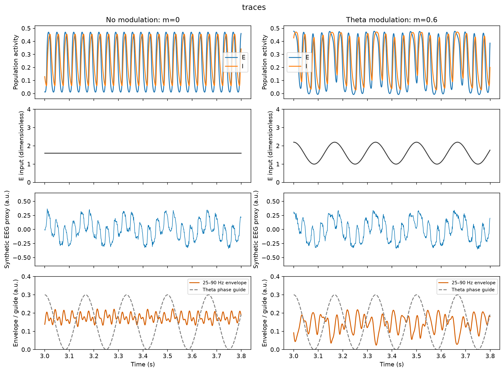
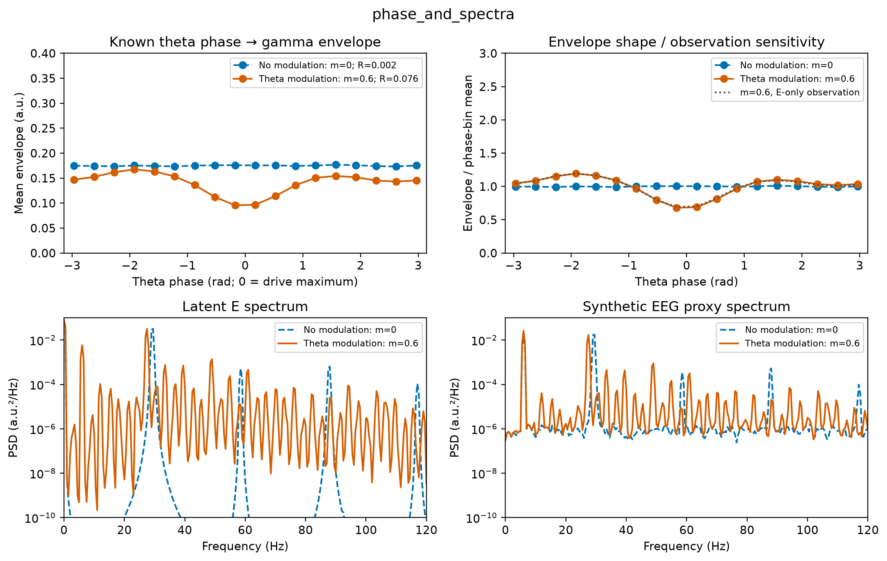
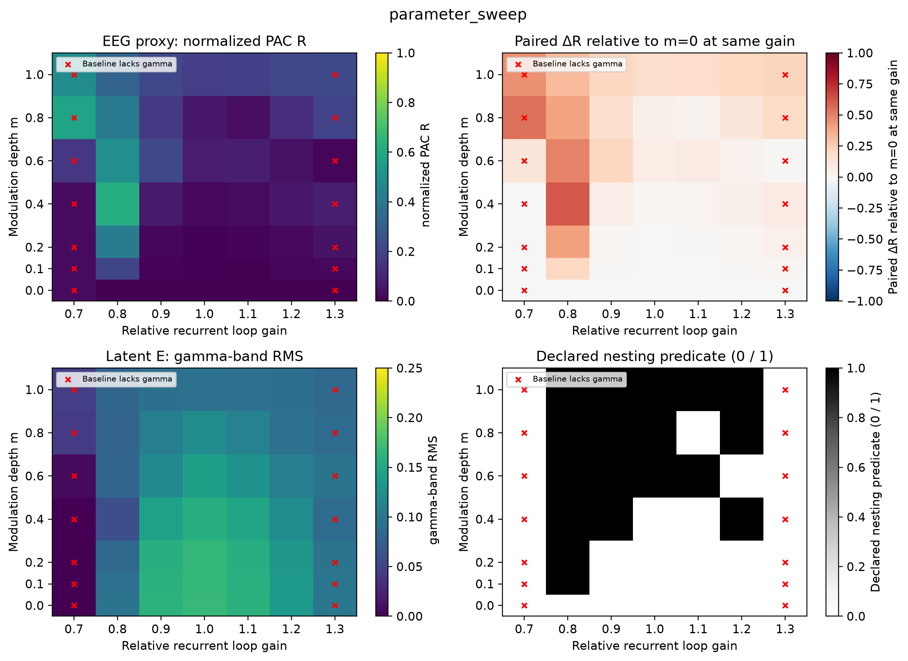

# Theta 调制 E–I gamma 群体回路

- Report status: final
- Scientific outcome: supported
- Review outcome: PASS
- Research question: theta 调制能否在示意性 E/I gamma 回路中产生相位–振幅嵌套？移除调制后如何变化？调制深度和回路增益如何影响结果？
- Evidence available: [独立审查 PASS](reviews/iteration-1.md)、[锁定规格](NeuroSpecification.md)、[实验与判定](evidence/result-assessment.md)、[原始运行](runs/production-02/artifact_manifest.json)、[验证](evidence/tests.json)、[收敛](runs/production-02/metrics/convergence.npz)。
- Missing evidence: none within the locked illustrative scope.
- Current conclusion: 预定展示条件满足预先声明的嵌套判据；参数效应不单调，部分基线不满足 gamma 条件。
- Next action: Completed.

这是用户批准的 illustrative / phenomenological 演示。模型输出、参数和 EEG 代理均为合成构造；不主张生物真实性、实测 EEG、内源 theta 或机制唯一性。baseline 使用事先锁定的无调制选参规则，不能把结果当作生物参数估计。

## 结果

预定展示条件为相对回路增益 1、调制深度 m=0.6，比较同一初始状态、同一观测噪声的 m=0 对照。这里 gamma 的操作定义是 **25–90 Hz**。无调制基线的主峰是 29.5 Hz，加入 6 Hz theta 调制后为 27.5 Hz；移除调制后 gamma 仍存在。

| 初始状态 / 观测种子 | 无调制 PAC R | theta 调制 PAC R | 配对 ΔR | 逐周期循环移位 null95 |
|---|---:|---:|---:|---:|
| (0.10, 0.10) / 11 | 0.001998 | 0.076167 | 0.074169 | 0.017859 |
| (0.12, 0.08) / 23 | 0.000416 | 0.076094 | 0.075679 | 0.018769 |
| (0.08, 0.12) / 37 | 0.000810 | 0.074178 | 0.073367 | 0.017497 |

三个敏感性设置均满足预设条件：保留足够 gamma 活动、ΔR>0.05、调制条件的 R 超过 200 个逐周期独立循环移位替代值的第 95 百分位。它们是确定性初始状态与观测噪声的敏感性设置，**不是三个生物学样本**；替代分析也仅检查相位对齐，不提供总体显著性推断。MI 从约 0.000005 增至 0.00408–0.00414。



图中左右均为相对增益 1，展示第一个敏感性设置的 3–3.8 s。自上而下为 E/I 活动、实际 E 输入、模拟 EEG 代理、25–90 Hz 振幅包络。横轴秒，群体活动与驱动无量纲，代理与包络为任意单位。两侧共享尺度；灰虚线仅是缩放后的 theta 相位指示。EEG 代理在无调制条件下仍含相同的直接 theta 分量，因此“代理信号中有 theta 和 gamma”本身不足以说明嵌套。



相位剖面使用 3–13 s 的 60 个 theta 周期，按已知输入相位分成 18 箱。左上显示原始箱均值，右上仅为比较形状而除以各自剖面均值；没有将原始 EEG 或 PSD 按条件重新缩放。**theta 驱动达到峰值的相位 0 附近，gamma 包络反而降低**，两侧出现较宽的隆起；这不是“theta 峰值必然增强 gamma”的演示。包络有多峰形状，不能把第一圆矩的角度解释为唯一的 burst 位置。下方 Welch PSD 使用 2 s 窗、1 s 重叠，保留绝对功率尺度。

观测映射检查中，latent E−0.5I 的 R 为 0.07641–0.07643；改为 E-only 代理后为 0.07177–0.07324。仅保留直接 theta 加同一噪声时，R 为 0.01638–0.02869，均低于各自替代分布的 null95（0.03098、0.03352、0.03887）。有限噪声仍会产生非零样本 PAC，不能以单个非零 R 宣称嵌套。

## 深度与回路增益扫描



图显示第一个敏感性设置的全部 7×7 个采样点：横轴相对递归增益，纵轴调制深度 m；非均匀深度坐标按真实单元边界显示，不插值。四个面板分别为代理 R、同增益对照的 ΔR、latent E gamma RMS、完整嵌套判据。红叉标记配对基线不满足 gamma 定义的样本，其连续数值仍显示并保存；分类面板中红叉下的 0 表示未通过基线资格，不能当成已确认的“无嵌套”。

每个敏感性设置有 18/49 个采样点通过完整判据。14/49 个点的基线不合格：相对增益 0.7 的基线近静止，1.3 的主峰为 24.5 Hz，低于预设 gamma 下限；即使有 gamma 频带功率，也不能把它自动认作已有 gamma 振荡。其余 35 个合格点中有 17 个未通过嵌套判据，全部保留在 [逐点 CSV](evidence/sweep.csv)。

调制深度与回路增益都没有呈现普遍的单调关系。例如增益 1.1 时，m 从 0.6 增到 0.8，R 从约 0.084 降到 0.038；增益 0.8 时，所采样的 m=0.4 对应 R≈0.620，继续增加深度反而下降。这里只报告采样点，不能由稀疏网格推断连续稳定区域或普适最优值。

## 模型、观测与验证

模型由 `brainmass.WilsonCowanStep` 实现，`Simulator` 管理初始化、BrainState 编译时间循环和独立条件/批轴。科学方程为：

\[
\tau_E\dot E=-E+(1-E)F_E(16gE-12gI+P),\quad
\tau_I\dot I=-I+(1-I)F_I(15gE-3gI),
\]

\[
F_j(z)=\mathrm{sigmoid}[a_j(z-\theta_j)]-\mathrm{sigmoid}(-a_j\theta_j),\quad
P=1.6+m\cos(2\pi\,6t).
\]

τE=4 ms，τI=8 ms，(aE,θE,aI,θI)=(1.2,2.8,1,4)。绝对增益 g=1.2×相对增益；1.2 和 P0=1.6 是从 18 个无调制候选中，按事先声明的规则选出的结果（8 个合格），随后才运行调制。当前环境的交叉权重关键词方向与公开文档叙述不一致，已通过解析导数测试确定映射，详见 [接口方向记录](evidence/api-direction-discrepancy.md)。实际执行的耦合方向与上式一致。

EEG 代理为去除 post-burn 均值后的 E−0.5I，加上 0.15 cos(theta) 与 SD=0.02 的高斯观测噪声。直接 theta 与观测噪声在配对条件间保持相同；回路内不加过程噪声。这里没有电极、头模型、偶极或电压标定，因此只使用 a.u.，不使用 μV。输入 theta 是外部指定信号。

模拟时长 14 s、burn-in 2 s，RK4、dt=0.1 ms，按 1 ms 点采样；统计固定使用 3–13 s。输入按步左端时间求值，监测为更新后时间，实际驱动和两种时间定义均已保存。25–90 Hz 零相位滤波、Hilbert 包络和 Welch PSD 使用 BrainTools；R 与 KL/MI 按已知外部相位计算，避免从混合代理信号中反推 theta 相位。

21 个预设半步长检查（全部增益×m=0、0.6、1.0，初始状态 lane 0）全部通过。gamma RMS 最大相对差约 0.0021%，峰值频率差 0 Hz，R 最大绝对差约 0.000032。解析导数、状态重置、批处理与单条件一致性、JIT/非 JIT 及最终状态一致性、已知 AM 正对照、恒定振幅负对照、替代值与直接循环移位一致性、配对观测噪声及保存指标重建均通过。采用原生编译批处理；没有宣称未经测量的加速比。主运行含编译与分析约 8 s，进程峰值 RSS 约 1 GiB；详见 [资源记录](runs/production-02/metrics/resources.json)。

offset sigmoid 在部分扫描条件产生最小约 −0.023 的抽象 E 活动，处于其方程不变域内；这再次限制了生理解释。PAC 还可能混合波形变化、谐波和频率调制，不能据此识别唯一生物机制。数值验证覆盖预设条件，不等于所有未采样参数或其他观测模型均可靠。

## 失败、复现与审查

所有开发失败与旧运行均保留：[运行沿革](evidence/run-lineage.md)。`production-01` 的逐周期相位随机化近似被 `production-02` 的精确振幅循环移位替代；两次 E/I 轨迹逐元素相同，正式判定使用后者。首版诊断图色标上限 0.5 会截断最高 R，已扩展到完整数学范围 [0,1]，原图保留在 `figures/first-render/`，见 [显示修正记录](evidence/figure-range-correction.md)。未改变阈值、条件或选择展示案例。最早 smoke 的可变 status 文件哈希与初始清单不同，所有不可变文件哈希及正式运行清单均验证通过。

在当前环境复现：

```bash
cd /workspace/theta_gamma
JAX_PLATFORMS=cpu /brainx-venv/bin/python test_checks.py
JAX_PLATFORMS=cpu /brainx-venv/bin/python launch.py production-replay production_exact_config.json
```

使用新 run ID 避免覆盖原始记录。正式运行的 [配置](runs/production-02/config.json)、[环境](runs/production-02/environment.json)、[源代码哈希](runs/production-02/provenance.json)、[日志](runs/production-02/run.log) 与 [完整清单](runs/production-02/artifact_manifest.json) 可追溯。原始轨迹、观测及分析 NPZ 均按 time×lane×condition（统计结果另带 signal 轴）保存；轴说明见 [规格](NeuroSpecification.md)、[分析代码](analysis.py) 和 [图清单](FIGURE_MANIFEST.md)。

独立 Codex MCP 审查已 **PASS**，科学结果为 **SUPPORTED**，无修改项：[审查原文](reviews/iteration-1.md)。审查者从原始轨迹独立重建了观测、滤波、包络、谱、全部 200 个替代值与分类判据；其直接重跑包测试受到只读 Matplotlib 缓存权限限制，原执行环境测试证据与独立数值重建支持本次通过。最终图在 PASS 后导出并检查，数值与诊断图逐元素相同，见 [最终图核验](evidence/final-figure-checks.json)。
