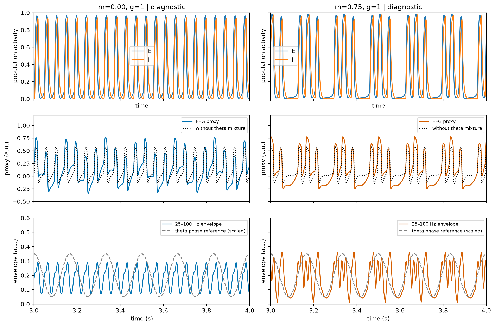
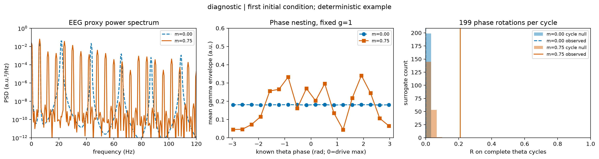
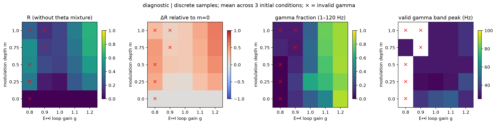

# Theta 调制 E-I gamma 群体回路

- Report status: draft
- Scientific outcome: partially_supported
- Review outcome: REFUSE
- Research question: theta 调制能否在指定 E/I 群体回路中产生相位嵌套？移除调制后，嵌套和模拟 EEG 代理如何变化？
- Specification: [NeuroSpecification.md](NeuroSpecification.md)（locked；用户授权代理选择全部设置）
- Evidence available: [数值验证](checks/verification.json)、[扫描](runs/production-01/manifest.json)、[dt 减半](runs/convergence-01/manifest.json)、[结果判定](result-assessment.md)、[载波审计](checks/carrier-audit.json)。
- Missing evidence: 独立 review；尚未建立自主 gamma 载波。
- Current conclusion: provisional：模型展示 gamma 频段包络与 theta 相位的嵌套，但自主基频约 22 Hz，43.5 Hz 峰属于谐波，不能将这一版称为完成的 gamma 回路。
- Next action: step 5，独立 Codex MCP review；保留部分失败后，在用户已委托的范围内修正时间尺度并重新验证。
- Figure status: diagnostic，未接受；[manifest](FIGURE_MANIFEST.md)。

## 初版结果（provisional）

固定 g=1，3 组初值，m=0/0.75。以已知驱动相位衡量，首初值 R 从
0.000112 增至 0.209661，18-bin MI 从 0.000003 增至 0.059404。
EEG 代理含相同 0.2 theta 混合项；移除此混合项几乎不改变 R。
不过，E 活动的主谱峰为 22 Hz，实际峰计数约 21.76 次/秒；gamma 带内
43.5 Hz 峰是高次谐波。该结果支持频段定义的相位包络依赖，未完成用户要求的自主 gamma 回路。

横轴秒，纵轴为无量纲 E/I、a.u. 代理和 25–100 Hz Hilbert 包络；两列分别为
无调制和有调制。首初值 3–4 s，灰虚线仅为缩放的外部相位参考。曲线没有群体统计置信区间。

左图为代理 Welch PSD，中图为已知 theta 相位的 18-bin 平均 gamma 包络，右图为
199 次完整 theta 周期独立相位旋转零模型。蓝虚线是 m=0，橙实线为 m=0.75。
PAC 不区分自主 gamma 与非正弦波谐波；不能据此识别独特生物机制。

5×5 离散网格，3 初值均值，无插值、无统计置信区间。红叉表示至少一个初值
未通过原 gamma 频段有效性标准；高 R 的无效点仍显示。该标准对谐波不够严格。
原始连续指标与所有失败记录均保留在 [metrics](runs/production-01/metrics/metrics.csv)
及 [failure-log](failure-log.md)。

Euler 首 20 ms 轨迹误差随 dt 逐次减半。固定展示点 dt=0.1/0.05 ms 的最大
R 差为 0.002044，带峰差为 0 Hz；这些数值通过不能修复载波解释上的失败。
全部结论仅适用于现象学模拟；无实测 EEG、生物真实性或机制唯一性主张。

## Independent review — REFUSE

[Verbatim review](reviews/iteration-1.md), thread 01a1a3e1-de71-7a91-ae87-2177c7c76941.
BX-001: gamma carrier unestablished; BX-002: regenerate consistent claim matrix; BX-003: native sigmoid.
Diagnostic figures remain unaccepted. Next action: iteration 2 step 1 restudy, then revised gamma-carrier experiment.
