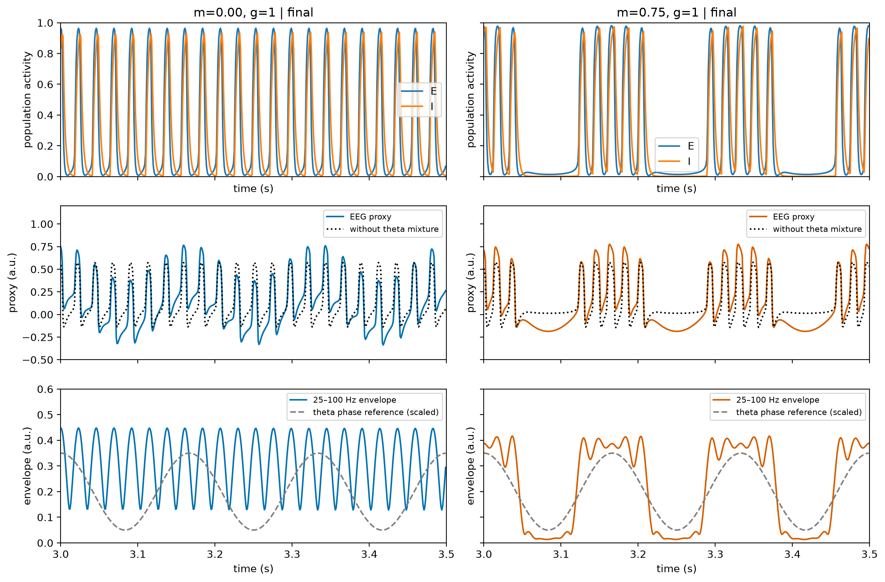
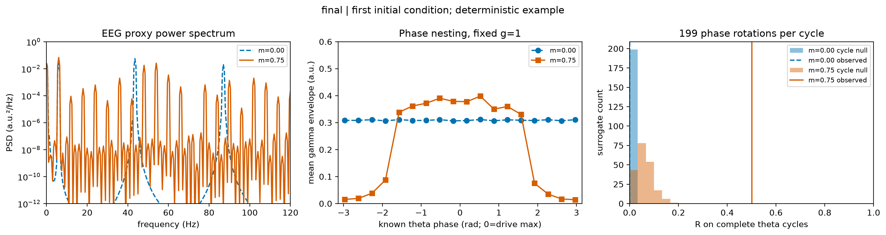
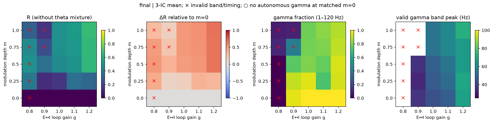

# Theta 调制 E-I gamma 群体回路

- Report status: final
- Scientific outcome: supported
- Review outcome: PASS
- Research question: theta 调制是否使 E/I gamma 回路产生相位嵌套；移除调制时，嵌套与模拟 EEG 代理如何变化；调制深度和回路增益如何影响结果？
- Specification: [NeuroSpecification.md](NeuroSpecification.md)，revision 2 locked；全部设置依据用户明确委托选择。
- Evidence available: [完整扫描与溯源](runs/production-02/manifest.json)、[dt 减半复算](runs/convergence-02/manifest.json)、[验证](checks/verification.json)、[确定性判定](result-assessment.md)、[claim–evidence](claim-evidence.md)。
- Missing evidence: none within accepted illustrative scope
- Current conclusion: 在所选现象学参数下，回路具有约 43.5 Hz 的自主 gamma 载波；6 Hz 外源驱动使 gamma 包络依赖 theta 相位，移除驱动周期项后此依赖接近零。
- Next action: 流程完成；保留全部成功、失败与不支持预期的设置。
- Figure status: final，见 [FIGURE_MANIFEST.md](FIGURE_MANIFEST.md)。

## 模型与比较

采用无 refractory 项、未减基线 logistic 的 Wilson–Cowan E/I 群体模型。
τE=1.25 ms，τI=2.5 ms；wEE=16，wII=3，I→E 权重为 −12g，E→I 为 +15g。
E 输入 P(t)=1.25+m cos(2π·6t)，I 外部输入为 0。所有活动均为无量纲。
EEG 代理 y=E−0.5I+0.2cos(2π·6t)，单位 a.u.；没有实验 EEG、头模型或物理电位标定。

每个增益和初值都有 m=0 成对控制。移除的仅是回路输入的 theta 周期项；代理中
相同的 theta 混合项继续保留，从而检查“有 theta 波形”是否等于“有动力学嵌套”。
另计算 E−0.5I（无 theta 混合）、E、E−I 三种观测映射。

CPU float64，BrainMass Simulator 原生批处理，Euler dt=0.05 ms。
每条模拟 12 s，去掉前 2 s，记录间隔 1 ms；滤波后各去掉 0.5 s 边缘。
扫描 m=[0,0.25,0.5,0.75,1]、g=[0.8,0.9,1,1.1,1.2]，3 组固定初值，合计 75 条轨迹。
初值是数值敏感性检查，不是独立动物样本；没有群体推断置信区间。

## gamma 载波与相位嵌套

在预定 g=1、m=0 控制中，首初值 E 周期计数频率为 43.527 Hz，
I 为 43.527 Hz，E/I 主谱峰均约 43.5 Hz。
E 周期间隔 CV=0.0069。三初值均通过周期频率、主谱峰与幅度的联合载波标准。
有调制时活动呈 theta 周期中的快振荡簇；E/I 约 79.9%/79.9% 峰间隔落在 10–40 ms。
驱动后 E 平均峰计数频率约 29.90 Hz，包含簇间停顿，不能把它等同于簇内瞬时频率。

两列为 m=0 与 m=0.75，均取首初值、g=1、3–3.5 s。上排为无量纲 E/I，中排为 EEG 代理
与去 theta 混合后的代理（a.u.），下排为 25–100 Hz 的四阶零相位 Butterworth/Hilbert 包络。
灰虚线仅是缩放后的外部 theta 相位参考。纵轴与处理在两列中固定。
移除调制仍保留快回路振荡；加入调制后快活动和包络在 theta 周期内聚集。

主指标 R=|mean(Aγ exp(iφθ))|/mean(Aγ)，使用已知驱动相位，0 rad 为输入最大值。
18-bin Tort MI 同时保存；不依赖从代理估出 theta 的主指标可避免弱 theta 相位不可靠的问题。

| 代理指标，首初值 | 无调制 m=0 | 调制 m=0.75 |
|---|---:|---:|
| R | 0.000272 | 0.501625 |
| Tort MI | 0.000005 | 0.122619 |
| 完整周期零模型 R 的 95% 分位 | 0.002814 | 0.125484 |
| gamma 带内峰 (Hz) | 43.5 | 54.0 |

左图是代理 Welch PSD（0.5 Hz 分辨率，a.u.²/Hz），中图是 theta 相位各 bin 的平均 gamma 包络，
右图是 199 次逐完整 theta 周期独立相位旋转的零模型。中图对所有保留时间做相位归并；
与时序中有节律的快活动一致。相位旋转保留周期内波形，检验跨周期相位一致性；其分位与
描述性 p 值不代表生物统计显著性。谱中有 6 Hz 高次谐波，不能把受驱动谱峰解释为独立、固定频率的 gamma 源。

## 参数扫描与不支持预期的设置

横轴 g 同时缩放两个交叉连接，纵轴 m 是无量纲输入幅度。每格为三初值均值，无插值。
依次显示无 theta 混合代理的 R、相对同 g 的 m=0 的 ΔR、gamma/1–120 Hz 功率比和有效 gamma 带峰。
红叉表示当前频段/快周期标准无效；圆圈表示同 g 自主控制没有通过 gamma 载波标准。
无效点的原始连续指标仍显示和保存；不将高 R 自动判为成功。

| m \ g：无 theta 混合代理平均 R | 0.8 | 0.9 | 1.0 | 1.1 | 1.2 |
|---|---:|---:|---:|---:|---:|
| 0 | 0.000 | 0.000 | 0.000 | 0.000 | 0.000 |
| 0.25 | 0.406 | 0.129 | 0.157 | 0.366 | 0.332 |
| 0.5 | 0.506 | 0.371 | 0.480 | 0.508 | 0.662 |
| 0.75 | 0.478 | 0.240 | 0.502 | 0.532 | 0.662 |
| 1 | 0.308 | 0.155 | 0.506 | 0.546 | 0.676 |

g=0.8 的所有深度均未通过当前快周期/频段标准；g=0.9、m≥0.75 也有无效设置。
这保留了高 R 却缺少有效 gamma 证据的情况。结果对 m、g 并非普遍单调，且只描述这些离散采样点，
不推断连续区域边界或全局最优。完整每初值、每观测指标见 [CSV](runs/production-02/metrics/metrics.csv)。

## 数值、观测与失败记录

- proxy 的三初值 ΔR 范围：0.501335–0.501410。
- no_theta 的三初值 ΔR 范围：0.501335–0.501410。
- E 的三初值 ΔR 范围：0.486307–0.486381。
- E_minus_I 的三初值 ΔR 范围：0.494029–0.494066。

所有观测映射与两个预定子时间窗都保留在 [assessment.json](assessment.json)，不省略反向或弱效应。
固定展示点以 dt=0.025 ms 重算，跨四观测和三初值最大 R 差为 0.001347，
gamma 带峰最大差为 0.0 Hz，均通过冻结的数值标准。
扫描其余点没有逐点 dt 认证，其边界不作精确数值主张。

[验证记录](checks/verification.json)包括方程一步值、实际输入、状态范围、批处理与单条轨迹/最终状态一致、
同一模型重置、JIT 一致性、独立自适应求解器的 Euler 一阶收敛、已知 AM 的 R、线性混合零对照、
原生 sigmoid 一致性，以及 beta 基波带 gamma 谐波的载波负对照。SciPy 边界见 [API-gap.md](API-gap.md)。

初版采用 τE=2.5 ms、τI=5 ms，产生约 22 Hz 基频，43.5 Hz 只是谐波；
它虽显示 gamma 频段包络嵌套，未完成 gamma 回路目标。独立 [iteration-1 review](reviews/iteration-1.md)
给出 REFUSE。原始扫描、失败测试、旧规格与旧图全部保存在 [初版报告](iterations/iteration-1/report.md)、
[初版数据](runs/production-01/manifest.json) 和 [failure-log.md](failure-log.md)。
修订版共同缩短时间常数的选择是基于此失败的现象学校准；新的完整扫描与固定对照在修订规格冻结后运行。

## 允许的解释与复现

结果展示指定外源 theta 输入在这个 E/I 群体模型中，足以改变快活动包络与 theta 相位的关系。
线性混合 theta 本身在无调制控制中未产生同等 R，但其他非线性观测、非正弦波谐波或其他机制仍可产生 PAC。
本模型不证明内源 theta 的生成、真实 EEG 的来源、生物真实性或机制唯一性；固定代理和单位均不能替代实测数据。
要区分生物机制，需要独立操纵慢输入并测量细胞类型分辨的快活动与传导/观测过程，本项目未作该实验预测验证。

入口为 [model.py](model.py)、[experiment.py](experiment.py)、[launch.py](launch.py)；
每次运行的配置、环境、命令、源代码快照、日志和 SHA256 都在 manifest 中。
在已有 Python 环境，使用 `JAX_PLATFORMS=cpu JAX_ENABLE_X64=true python launch.py production <新的run-id>`
可生成同配置的新快照；运行目录必须是新名字，以保留原记录。代码无训练或拟合步骤。

独立验收：[iteration-2 review](reviews/iteration-2.md)，PASS；接受范围为上述 illustrative/phenomenological 模型与保存的结果。
