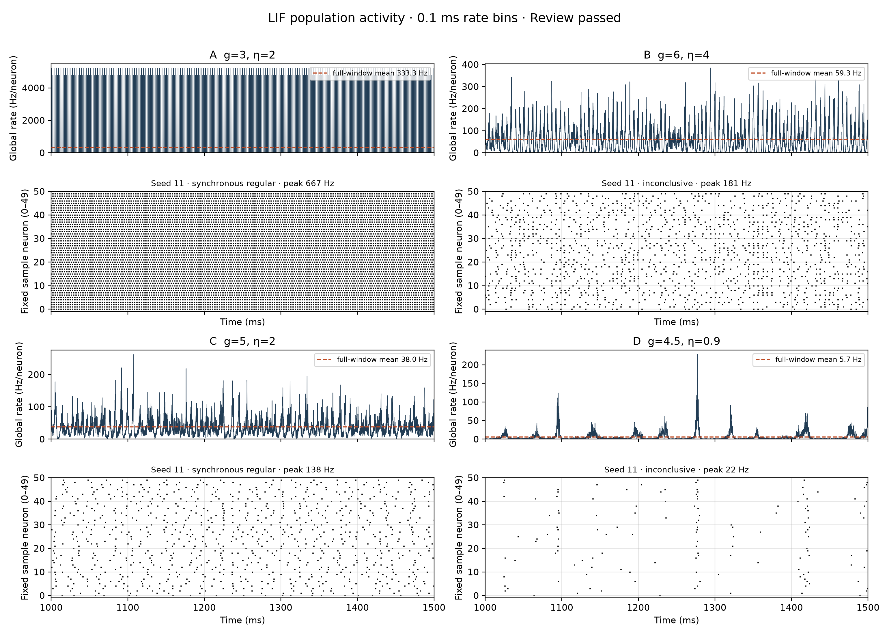
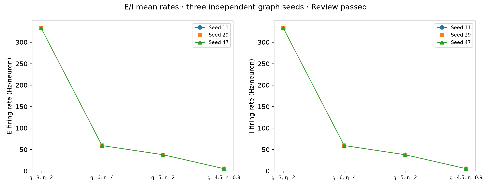
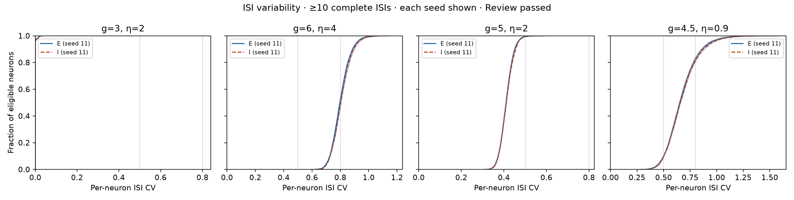
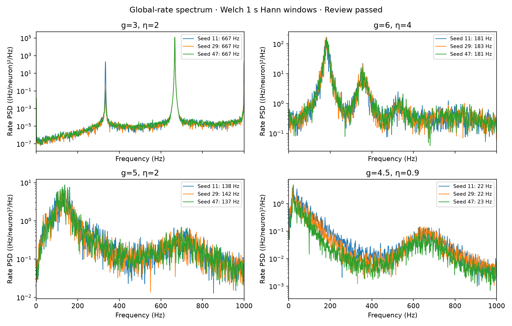
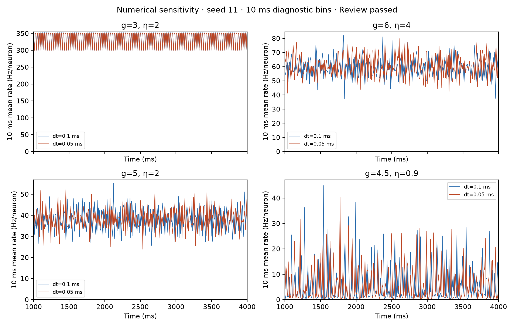

# First-principles LIF regime exploration
- Report status: final
- Scientific outcome: partially_supported
- Review outcome: PASS
- Research question: Do the four supplied parameter pairs exhibit the four requested activity regimes under the locked operational tests?
- Evidence available: 12 primary simulations and four timestep checks in `runs/locked-baseline-v2`, exact graphs, all spikes, per-neuron statistics and spectra; component and raw-evidence audits.
- Missing evidence: none.
- Current conclusion: Only claims within the locked numerical protocol are assessed; requested labels are never forced.
- Next action: complete.

The supplied network sizes, exact indegrees, voltage jumps, drive equation, 1.5 ms recurrent delay and four conditions were preserved. All unspecified choices and operational thresholds were delegated and recorded in [NeuroSpecification.md](NeuroSpecification.md), with its pre-simulation hash in specification.sha256. The initial specification was not changed after outcomes. [first-principles.md](first-principles.md) derives the equations and explains the assumptions. No papers, scientific examples or existing scientific implementations were consulted; public library contracts were used only for mechanics.

The existing Windows WSL2 / Docker environment ran JAX on CPU with float32 voltage State. Each of seeds 11, 29 and 47 supplied an independent graph, initialization and input stream, paired across conditions. Each run lasted 4 s, with a 1 s burn-in and 3 s observation. Four additional seed-11 runs halved integration dt from 0.1 to 0.05 ms; their rate evidence was rebinned to 0.1 ms. Numerical sensitivity compares statistics, because grid-dependent Poisson draws differ. No fitting or calibration was performed.

| (g, η) | Requested regime verdict | E rate (Hz/neuron) | I rate (Hz/neuron) | Median ISI CV | Global peak (Hz), seeds 11 / 29 / 47 |
|---|---|---|---|---|---|
| (3, 2) | synchronous regular: **supported** | 333.331–333.332 | 333.331–333.332 | 0.000–0.000 | 667 / 667 / 667 |
| (6, 4) | fast synchronous irregular: **inconclusive** | 59.319–59.361 | 59.386–59.444 | 0.798–0.805 | 181 / 183 / 181 |
| (5, 2) | asynchronous irregular: **unsupported** | 37.969–38.168 | 37.939–38.079 | 0.409–0.411 | 138 / 142 / 137 |
| (4.5, 0.9) | slow synchronous irregular: **inconclusive** | 5.531–5.684 | 5.545–5.681 | 0.648–0.661 | 22 / 22 / 23 |

The requested synchronous regular case is supported across all three primary seeds and the timestep check. The fast case crosses the frozen CV=0.8 irregularity boundary across seeds and is timestep sensitive, so its requested label is inconclusive. The requested asynchronous case instead meets the frozen synchronous regular rules at both timesteps. The slow case has a 22–23 Hz peak but median CV between the frozen regular and irregular thresholds, leaving its requested irregularity inconclusive.

Ranges show the minimum and maximum across three graph seeds, not a confidence interval. ISI CV uses each neuron’s complete observation-window intervals, population SD/mean, with at least ten intervals required; per-population eligibility is retained in every metrics JSON. The global spectral maximum is selected within 1–1000 Hz from Welch PSD using 1 s Hann segments and 50% overlap. A population spectral peak is distinct from a neuron’s mean firing frequency; a peak alone does not prove an irregular or asynchronous regime.

The frozen synchrony predicate requires F1≥5, relative 1 ms modulation c1≥0.15 and spectral prominence P≥10. Asynchrony requires F1<5 and c1<0.15. Median ISI CV≤0.5 counts as regular, CV≥0.8 as irregular, and the interval between these thresholds is inconclusive. Synchronous irregular activity is fast at ≥50 Hz and slow below 50 Hz. Support requires all three primary seeds and the seed-11 fine-dt label to match the request. The full continuous evidence and exact labels are in [result-assessment.md](result-assessment.md).

| (g, η) | Primary seed-11 label | Fine-dt label | Primary CV → fine CV | Primary peak → fine peak (Hz) |
|---|---|---|---|---|
| (3, 2) | synchronous regular | synchronous regular | 0.0000 → 0.0000 | 667 → 667 |
| (6, 4) | inconclusive | fast synchronous irregular | 0.7979 → 0.9279 | 181 → 181 |
| (5, 2) | synchronous regular | synchronous regular | 0.4111 → 0.4132 | 138 → 136 |
| (4.5, 0.9) | inconclusive | inconclusive | 0.6550 → 0.6473 | 22 → 23 |

These are results of the declared finite-grid model. Timestep-sensitive regularity is not evidence of numerical convergence or a universal regime assignment. The delegated rest voltage, refractory input handling, graph exclusions and endpoint arrival convention are conditional assumptions; this study does not attribute any label mismatch to a particular assumption without an intervention testing it. Three seeds and a 3 s observation interval do not establish a thermodynamic phase boundary or biological validation.

The main figure uses the fixed first seed and first 500 ms after burn-in. Each unsmoothed 0.1 ms global rate trace sits above its raster for the same randomly chosen 50 neuron identities. Dashed lines give each full 3 s mean. Axes are in ms and Hz/neuron; rate y scales vary by condition and are labeled. Raster rows are the fixed sampled identities in increasing order, with original IDs in runs/locked-baseline-v2/sample_neurons.npy. The first condition has strong periodic population events and regular individual firing. The other panels show weaker, variable fast modulation or sparse slow bursts; their visual appearance alone does not establish the requested labels.

Each marker is a complete-run E or I mean for one graph seed; lines link paired seeds across conditions and are descriptive, not an interpolated phase diagram. There are three independent network realizations per condition. E and I mean rates are close within every condition, with little spread across these seeds; the supplied condition order spans approximately 333, 59, 38 and 5.6 Hz/neuron.

The empirical cumulative distributions retain all eligible neuron CVs separately for E and I. Seed 11 is bold; the other seeds are faint. Dotted vertical lines mark the frozen regular/irregular boundaries. These are neuron distributions within network realizations, not independent network replicates. Near-zero CVs distinguish the first condition; the fast case lies around the irregularity boundary, the requested asynchronous case is below the regularity boundary, and the slow case lies between them.

The population spectra use the full observation interval and Hz/neuron rate normalization. Each curve represents one seed; legends report the strongest 1–1000 Hz bin. PSD units are (Hz/neuron)²/Hz. No smoothing beyond the declared Welch estimator is applied. The strongest peaks separate the supplied cases at 667, 181–183, 137–142 and 22–23 Hz; these are global-rate peaks, including possible harmonics, rather than inferred single-neuron firing frequencies.

The timestep comparison shows the entire 3 s observation interval in explicit 10 ms mean-rate bins, solely to reveal slow modulation and temporal variability. This coarser diagnostic does not replace the required 0.1 ms main rates or the locked assessment. The first condition retains its periodic activity, while variable traces in the other conditions have similar rate scales. The table above exposes the fast case’s CV change from 0.7979 to 0.9279, which rate traces alone would conceal. Different timesteps consume different Poisson draws, so pointwise curve agreement is not expected.

Checks and provenance: [checks.json](checks.json) verifies analytic leak, refractory timing, mean-input firing period, actual delayed target-voltage onsets, Poisson mean/variance/independence, exact compiled/uncompiled spikes/State/RNG parity, replay and second-condition compilation. [analysis_checks.json](analysis_checks.json) checks known event rates/CVs and known frequency signals. [acceleration.json](acceleration.json) and [corrected_execution_parity.json](corrected_execution_parity.json) retain exact trajectory parity for execution changes.

The raw evidence is under [runs/locked-baseline-v2/raw](runs/locked-baseline-v2/raw); every event is losslessly encoded. [Metrics CSV](runs/locked-baseline-v2/metrics.csv), [raw audit](runs/locked-baseline-v2/raw_audit.json), [artifact manifest](runs/locked-baseline-v2/artifact_manifest.json), [run command](runs/locked-baseline-v2/command.txt), [source snapshot](runs/locked-baseline-v2/code/model.py) and [environment provenance](runs/locked-baseline-v2/environment.json) allow inspection and replay. The root validation script adds a target-voltage onset check beyond the archived pre-launch validation snapshot, with no change to simulation code.

A partial parent run failed at compilation of its second condition because a sparse-operator workspace retained a tracer. It remains preserved in runs/locked-baseline, with one complete unaccepted condition and an exit code of 1. Initializing the public communication operator eagerly before tracing corrected the issue; the entire first trajectory, including burn-in, final voltage, refractory State and RNG key, is bit-for-bit identical. All sixteen corrected runs completed under the same scientific specification. Earlier implementation-check failures and logs are also retained.

The final spectral backend is [BrainTools spectrogram plus segment averaging](analysis_spectrum.py), using the exact frozen periodic Hann and per-segment constant detrending. [All sixteen offline spectral comparisons](analysis-iteration-2/braintools-final/parity.json) reproduce every peak frequency and label and match PSD/P/Q within the declared numerical tolerances. Only this offline analysis uses float64; the archived neural simulations remain float32. Final spectral figures read the BrainTools arrays in analysis-iteration-2/braintools-final/metrics. The direct BrainTools power_spectral_density operation uses different fixed window/detrending behavior; that unfavorable comparison is preserved, and the suitable spectrogram API removes the original SciPy spectral boundary. See [API assessment](BrainTools-spectral-api-gap.md).

[Independent review, iteration 2](reviews/iteration-2.md), [prior refusal and required correction](reviews/iteration-1.md), and [figure manifest](FIGURE_MANIFEST.md).
